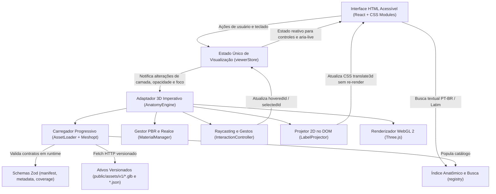

# Arquitetura Técnica — Anatomia 3D

Este documento detalha a arquitetura de software da aplicação web **Anatomia 3D** para as Fases 0 e 1, em conformidade com a [especificacao-tecnica-anatomia-3d.md](../especificacao-tecnica-anatomia-3d.md) e com as decisões registradas em [adr-decisoes-arquiteturais.md](./adr-decisoes-arquiteturais.md).

---

## 1. Visão Geral da Arquitetura

A aplicação é uma **SPA 100% cliente** construída em Vite + React + TypeScript, sem backend obrigatório no MVP. O princípio estrutural central é a **separação em três camadas com fronteiras rígidas**:

1. **Camada de Domínio e Estado (`src/core/`):** pura em TypeScript, sem dependência de DOM ou WebGL. Contém os contratos Zod, a store única de visualização e o catálogo indexado para busca.
2. **Adaptador de Cena 3D (`src/scene/`):** camada imperativa sobre Three.js (WebGL 2), responsável por ciclo de vida gráfico, carregamento progressivo de `.glb`, materiais PBR e realce reversível, *raycasting*, gestos e projeção de etiquetas 2D.
3. **Camada de Interface Acessível (`src/ui/`):** componentes React semânticos, responsivos e conformes à WCAG 2.2 AA, comunicando-se exclusivamente com `viewerStore` e invocando ações de alto nível no `AnatomyEngine`.



---

## 2. Estrutura de Diretórios Planejada

```text
projeto anatomia/
├── AGENTS.md
├── especificacao-tecnica-anatomia-3d.md
├── docs/                                # Documentação de engenharia e governança (esta pasta)
├── sources/                             # Material de referência somente leitura (não modificar)
├── public/
│   └── assets/
│       └── v1/                          # Unidade de lançamento versionada dos ativos
│           ├── manifest.json
│           ├── metadata-v1.json
│           ├── coverage-matrix.json
│           ├── skeletal-v1.glb
│           └── muscular-v1.glb
├── scripts/
│   ├── anatomy-catalog.mjs              # Catálogo canônico FMA -> anatomyId, PT-BR, Latim
│   ├── build-assets.mjs                 # Pipeline BodyParts3D STL -> .glb Meshopt + JSONs
│   └── validate-assets.mjs              # Gate de build: verifica .glb <-> metadata <-> coverage
├── src/
│   ├── main.tsx
│   ├── core/
│   │   ├── schema/
│   │   │   └── anatomy.ts               # Schemas Zod e tipos inferidos
│   │   ├── state/
│   │   │   └── viewerStore.ts           # Store única reativa + máquina de transições
│   │   └── anatomy/
│   │       └── registry.ts              # Índice bidirecional anatomyId <-> meshNodes + busca normalizada
│   ├── scene/
│   │   ├── AnatomyEngine.ts             # Fachada principal do canvas WebGL 2 + câmera + loop
│   │   ├── AssetLoader.ts               # GLTFLoader + MeshoptDecoder + carga progressiva + retry
│   │   ├── MaterialManager.ts           # Materiais clínicos, realce reversível, opacidade muscular
│   │   ├── InteractionController.ts     # Raycasting seletivo, histerese, tap vs. drag
│   │   └── LabelProjector.ts            # Projeção 3D -> 2D no DOM + anti-colisão + seta SVG
│   └── ui/
│       ├── styles/
│       │   └── tokens.css               # Design tokens globais, contraste AA, reduced-motion
│       ├── App.tsx
│       ├── CanvasViewport.tsx           # Contêiner WebGL, teclado no canvas e ancoragem da etiqueta
│       ├── LayerControls.tsx            # Músculos | Ossos | Ambos, Mostrar músculos, opacidade, qualidade
│       ├── AnatomyLabel.tsx             # Etiqueta flutuante HTML acessível + linha indicadora
│       ├── StructureDrawer.tsx          # Gaveta lateral (desktop) / bottom-sheet (mobile) pesquisável
│       ├── HelpModal.tsx                # Modal "Como navegar" (mouse, toque, teclado)
│       ├── CreditsModal.tsx             # Créditos CC BY-SA 2.1 JP, cobertura e aviso educacional
│       └── StatusOverlay.tsx            # Carregamento, erro de ativo (retry) e fallback WebGL
└── tests/
    ├── unit/                            # Testes Vitest (domínio, store, busca, lógica de interação)
    └── e2e/                             # Testes Playwright (desktop 1280x720, mobile 390x844 e 320x568)
```

---

## 3. Contratos da Camada de Domínio e Estado (`src/core/`)

### 3.1 Tipos Fundamentais

```typescript
export type AnatomySystem = 'muscular' | 'skeletal';
export type LayerMode = 'muscular' | 'skeletal' | 'both';
export type QualityMode = 'auto' | 'reduced';
export type SystemLoadStatus = 'idle' | 'loading' | 'loaded' | 'error';
export type WebGLStatus = 'initializing' | 'ready' | 'unsupported' | 'context_lost';

export interface SystemLoadState {
  status: SystemLoadStatus;
  progress: number; // 0..100
  errorMessage: string | null;
}

export interface ViewerState {
  visibleSystems: ReadonlySet<AnatomySystem>;
  muscleOpacity: number; // 0.15 .. 1.0 (padrão 1.0)
  hoveredId: string | null;
  selectedId: string | null;
  qualityMode: QualityMode;
  webglStatus: WebGLStatus;
  loadState: {
    manifest: SystemLoadStatus;
    skeletal: SystemLoadState;
    muscular: SystemLoadState;
  };
  drawerOpen: boolean;
  helpOpen: boolean;
  creditsOpen: boolean;
  announcement: string; // Alimenta região aria-live="polite"
}
```

### 3.2 Máquina de Estado de Camadas (`visibleSystems`)

O controle segmentado (`Músculos | Ossos | Ambos`) e o atalho rápido (`Mostrar músculos`) **leem e escrevem o mesmo `visibleSystems`**, garantindo impossibilidade de estados contraditórios (Seção 10.2 da spec). `LayerMode` é sempre um valor derivado:

- `has('muscular') && has('skeletal')` → `'both'` (`Ambos`)
- `has('muscular') && !has('skeletal')` → `'muscular'` (`Músculos`)
- `!has('muscular') && has('skeletal')` → `'skeletal'` (`Ossos`)

| Estado atual (`visibleSystems`) | Ação do usuário | Novo estado (`visibleSystems`) | `LayerMode` derivado | Efeito colateral na cena |
|---|---|---|---|---|
| Qualquer | `setLayerMode('muscular')` | `{'muscular'}` | `'muscular'` | Oculta `skeletal-system`, exibe `muscular-system` |
| Qualquer | `setLayerMode('skeletal')` | `{'skeletal'}` | `'skeletal'` | Oculta `muscular-system`, exibe `skeletal-system` |
| Qualquer | `setLayerMode('both')` | `{'muscular', 'skeletal'}` | `'both'` | Exibe ambas; aplica `muscleOpacity` atual |
| `{'muscular', 'skeletal'}` | `toggleMuscles()` (ocultar) | `{'skeletal'}` | `'skeletal'` | Oculta músculos mantendo ossos e câmera intactos |
| `{'muscular'}` | `toggleMuscles()` (ocultar) | `{'skeletal'}` | `'skeletal'` | Evita cena vazia revelando os ossos automaticamente |
| `{'skeletal'}` | `toggleMuscles()` (exibir) | `{'muscular', 'skeletal'}` | `'both'` | Reexibe músculos mantendo ossos e câmera intactos |
| Qualquer (sem o sistema da estrutura) | `selectStructure(anatomyId)` (via gaveta) | `visibleSystems ∪ {system}` (se sistema carregado) | `'both'` | Revela a camada ausente sem ocultar a atual, define `selectedId` e anuncia em `aria-live` |

**Regras adicionais de consistência de estado:**
- Se uma estrutura estiver em `hoveredId` ou `selectedId` e pertencer a um sistema que acabou de ficar oculto, esse ID é limpo automaticamente do estado ativo para que a etiqueta não aponte para uma malha invisível.
- Nenhuma transição de camada altera posição, alvo ou zoom da câmera nem dispara recarregamento de rede.
- **Estrutura exibida na etiqueta (`activeAnatomyId`):** resolvida por `hoveredId ?? selectedId`. Assim, se o usuário fixou uma estrutura por toque ou pela lista (`selectedId`) e no desktop passar o cursor brevemente por outra (`hoveredId`), a etiqueta acompanha temporariamente o *hover* e retorna ao item fixado quando o cursor sai, até que o usuário feche ou clique fora do modelo.

### 3.3 Índice Anatômico (`registry.ts`)

Após o carregamento validado de `metadata-v1.json`, o `AnatomyRegistry` constrói índices em memória $O(1)$ e de busca textual normalizada:

- `byAnatomyId: Map<string, StructureMetadata>`
- `byMeshNode: Map<string, string>` (mapeia cada nome de nó/submalha ao `anatomyId` pai)
- `search(query: string, filterSystem?: AnatomySystem | 'all'): StructureMetadata[]`:
  - Normaliza consulta e textos com `.normalize('NFD').replace(/[\u0300-\u036f]/g, '').toLowerCase()`.
  - Casa simultaneamente contra `displayName['pt-BR']`, `displayName.la`, `scientificName`, `anatomyId` e termos de lateralidade (`direito`/`esquerdo`/`left`/`right`).
  - Ordena priorizando correspondência no início do nome em português e agrupando por região/lateralidade.

---

## 4. Arquitetura do Motor 3D (`src/scene/`)

### 4.1 `AnatomyEngine.ts`

Responsável pelo ciclo de vida completo do WebGL 2 e coordenação entre sub-módulos:

- **Detecção e criação de contexto:** verifica disponibilidade de `WebGL2RenderingContext` antes de instanciar `THREE.WebGLRenderer`; caso indisponível, atualiza `webglStatus = 'unsupported'` sem lançar exceções não tratadas (`RF-09`).
- **Configuração de renderização clínica:**
  - `renderer.setClearColor(0x000000, 1)` (fundo preto puro conforme decisão confirmada).
  - `renderer.outputColorSpace = THREE.SRGBColorSpace` e `renderer.toneMapping = THREE.ACESFilmicToneMapping` com `toneMappingExposure = 1.05` (leitura de volume sem estourar brancos dos ossos nem saturar artificialmente músculos).
  - **Iluminação neutra de três pontos + ambiente sutil:**
    - `HemisphereLight(0xf4f6fa, 0x1b1e26, 0.55)` para preencher recessos anatômicos sem perder contraste no fundo preto.
    - Luz principal (*Key* `DirectionalLight`, cor neutra fria `0xfff8f0`, intensidade `1.45`) em posição frontal superior direita.
    - Luz de preenchimento (*Fill* `DirectionalLight`, `0xdbe6ff`, intensidade `0.65`) lateral esquerda oposta.
    - Luz de recorte (*Rim* `DirectionalLight`, `0xffffff`, intensidade `0.85`) posterior para destacar silhueta de escápula, clavícula e bordas musculares contra o fundo `#000000`.
- **Câmera e `OrbitControls`:**
  - `PerspectiveCamera` com `fov = 38` (baixa distorção anatômica em perspectiva) enquadrando inicialmente a vista anatômica **anterior** centralizada do recorte (com margem confortável acima da cintura escapular e abaixo dos antebraços).
  - `OrbitControls`: `enableDamping = true`, `dampingFactor = 0.08`, rotação livre 360° em azimute e polar `[0.15 rad, π - 0.15 rad]`, `minDistance` e `maxDistance` proporcionais ao raio da *bounding sphere* do modelo carregado (`0.6×R` a `5.0×R`), `enablePan = true` com limite para não perder o modelo fora da tela.
  - `resetView()`: retorna suavemente (ou instantaneamente quando `prefers-reduced-motion: reduce`) para a vista anatômica anterior padrão.
  - `focusStructure(anatomyId)`: calcula o centro e o tamanho da *bounding box* da estrutura e interpola `camera.position` e `controls.target` em direção ao lado externo anatômico mais legível (anterior ou posterior conforme a estrutura, evitando atravessar o tórax). Qualquer evento `start` do `OrbitControls` por ponteiro/teclado cancela imediatamente a animação automática.
- **Desempenho e resiliência:**
  - **Qualidade adaptativa:** em `qualityMode === 'auto'`, inicia em `Math.min(window.devicePixelRatio, 2)`; se a média móvel de FPS cair abaixo de `26 FPS` por mais de 2 segundos consecutivos (ex.: celular intermediário sob carga), reduz `pixelRatio` para `1.0` e informa discretamente sem interromper o uso. Em `qualityMode === 'reduced'`, trava `pixelRatio = 1.0` desde o início.
  - **Suspensão em aba oculta:** listener em `visibilitychange` interrompe o `requestAnimationFrame` quando `document.hidden === true` e retoma no retorno (Seção 13.2).
  - **Perda de contexto WebGL:** listeners no `<canvas>` para `webglcontextlost` (`event.preventDefault()`, `webglStatus = 'context_lost'`) e `webglcontextrestored` (`webglStatus = 'ready'`, reaplicação do estado de visibilidade e materiais).

### 4.2 `AssetLoader.ts`

Gerencia o carregamento validado, progressivo e resiliente dos ativos:

1. Faz *fetch* de `/assets/v1/manifest.json` e valida com `ManifestSchema` (Zod).
2. Faz *fetch* de `metadataUrl` (`metadata-v1.json`) e valida com `MetadataDocumentSchema` (Zod), verificando `manifest.assetVersion === metadata.assetVersion` e `manifest.metadataVersion === metadata.metadataVersion`.
3. Carrega **`skeletal-v1.glb` primeiro** usando `GLTFLoader` + `MeshoptDecoder`:
   - Assim que o esqueleto termina de decodificar, acopla `skeletal-system` à cena, ajusta a câmera inicial e libera a interação imediatamente (o usuário já pode orbitar e identificar os 10 ossos enquanto a musculatura termina de baixar).
4. Em seguida (ou em paralelo caso já em cache HTTP, aplicando na cena na ordem segura), carrega **`muscular-v1.glb`** e acopla `muscular-system` diretamente na origem da cena (sem reaplicar `sceneOriginOffset`, pois o deslocamento já é embutido nos vértices dos `.glb` durante `build:assets`).
5. **Falha isolada por camada (`RNF Confiabilidade`):** se `muscular-v1.glb` falhar por rede instável, `skeletal-system` permanece 100% interativo e um aviso não destrutivo oferece o botão **Tentar novamente** apenas para a camada que falhou (`retrySystem('muscular')`).
6. Durante o registro das malhas carregadas, cada `THREE.Mesh` recebe `mesh.userData.anatomyId` e `mesh.userData.system` resolvidos pelo `extras.anatomyId` (e validados contra `registry.ts`).

### 4.3 `MaterialManager.ts`

Controla aparência clínica, opacidade e realce reversível (Seção 8.1 e Seção 11.1 da spec):

- **Materiais-base PBR clínicos (sem brilho plástico de videogame):**
  - **Osso (`skeletal`):** `MeshStandardMaterial({ color: '#ddd6c7', roughness: 0.72, metalness: 0.04 })` — marfim fosco mineralizado com resposta nítida a luz de recorte.
  - **Músculo (`muscular`):** `MeshStandardMaterial({ color: '#8f3834', roughness: 0.56, metalness: 0.03 })` — tom miológico sóbrio com leve diferenciação tonal automática por grupo/cabeça quando necessário, sem perder a unidade visual.
- **Gestão de realce 100% reversível:**
  - Antes de alterar qualquer propriedade visual, o `MaterialManager` armazena um *snapshot* imutável por estrutura (`baseColor`, `baseEmissive`, `baseEmissiveIntensity`, `baseOpacity`, `baseRoughness`).
  - **Estados visuais aplicáveis a todas as malhas de um mesmo `anatomyId`:** (garantindo que, ao passar o cursor na cabeça longa do bíceps, **todo** o bíceps braquial esquerdo seja realçado de forma coesa)
    - `default`: restaura exatamente o *snapshot* + aplica `muscleOpacity` se for músculo.
    - `hovered`: eleva `emissive` para acento clínico quente (`#ff9e6d` em baixa intensidade `0.32` para músculo; `#6ec8ff` intensidade `0.28` para osso) + clareamento sutil da cor base (+12% em espaço linear).
    - `selected`: `emissiveIntensity` reforçado (`0.42`), destacando claramente a estrutura fixada mesmo com câmera distante.
    - `dimmed` (opcional sutil quando há estrutura fixada na gaveta): atenua levemente a saturação/luminosidade das demais estruturas da mesma camada para destacar o alvo sem fazê-las desaparecer.
- **Modo experimental de opacidade muscular (`muscleOpacity`):**
  - Quando `visibleSystems` contém apenas `'muscular'`, os músculos são renderizados em opacidade `1.0` (`transparent: false`, `depthWrite: true`), preservando leitura sólida.
  - Quando `visibleSystems` contém `'muscular'` e `'skeletal'` (`Ambos`):
    - Se `muscleOpacity >= 0.999`: `transparent = false`, `depthWrite = true`, `opacity = 1`.
    - Se `0.15 <= muscleOpacity < 0.999`: `transparent = true`, `depthWrite = false`, `opacity = muscleOpacity`, `renderOrder = 2` (enquanto ossos mantêm `renderOrder = 1` e `depthWrite = true`), garantindo que o esqueleto permaneça nítido através dos músculos.

### 4.4 `InteractionController.ts`

Gerencia *raycasting*, estabilidade de *hover* e separação entre gesto de câmera e toque de identificação (`RF-05`, `RF-06`, Seção 10.3 e Seção 14):

- **Alvos elegíveis ao *raycasting*:**
  - Apenas objetos pertencentes aos sistemas presentes em `visibleSystems` e com `object.visible === true`.
  - **Regra de opacidade baixa ("músculo fantasma"):** quando `visibleSystems` estiver em `Ambos` (`'muscular'` e `'skeletal'`) e `muscleOpacity <= 0.25`, a camada muscular é excluída da lista de *raycasting* para permitir apontar e selecionar ossos diretamente através da musculatura translúcida.
- **Controle de desempenho do *raycasting*:**
  - Executado apenas em eventos `pointermove` (mouse) ou ao fim de um toque simples elegível — nunca em `requestAnimationFrame` sem movimento de ponteiro.
- **Suspensão durante movimento da câmera:**
  - Ao receber evento `start` do `OrbitControls`, suspende imediatamente novas aberturas/trocas de *hover* (`isCameraMoving = true`) e oculta temporariamente o realce de *hover*; retoma apenas após `end` + pequeno respiro (`80 ms`).
- **Histerese anti-tremor no desktop:**
  - Na fronteira entre dois músculos adjacentes (ex.: deltoide vs. tríceps braquial), exige estabilidade mínima de `55 ms` antes de trocar o `hoveredId` para outro ID não nulo, evitando cintilação de etiqueta ao mover o mouse lentamente sobre costuras anatômicas. A saída para `null` (fundo vazio) também aguarda `70 ms` para tolerar micro-frestas entre malhas.
- **Heurística rigorosa Tap vs. Drag (dispositivos táteis e cliques):**
  - No `pointerdown`: registra `pointerId`, coordenadas `(x0, y0)`, timestamp `t0` e incrementa contador de ponteiros ativos.
  - Se `activePointers > 1` (pinça/pan com 2 dedos): invalida imediatamente o candidato a toque (`gestureInvalidated = true`).
  - No `pointermove`: se a distância euclidiana $\sqrt{(x - x_0)^2 + (y - y_0)^2} > 8\text{ px}$, marca `gestureInvalidated = true` (é arrasto/órbita, não toque).
  - No `pointerup`: somente dispara *raycast* de seleção se `!gestureInvalidated`, `activePointers === 1` antes de soltar e `performance.now() - t0 < 350 ms`.
  - Se o *raycast* atingir uma estrutura válida, alterna/define `selectedId`; se atingir o fundo preto, limpa `selectedId = null` (`RF-06`).

### 4.5 `LabelProjector.ts`

Projeta a âncora 3D da estrutura ativa para o elemento HTML de etiqueta sem causar *layout thrashing*:

- Opera dentro do loop de renderização **somente quando `activeAnatomyId !== null`**.
- Projeta `labelAnchor` (Vetor 3D em espaço mundo) com `anchor.clone().project(camera)`:
  - Se `ndc.z > 1` ou `ndc.z < -1` (atrás dos planos da câmera), oculta o contêiner da etiqueta com `visibility: hidden` sem removê-lo do DOM (mantendo a leitura pelo `aria-live`).
- Converte coordenadas NDC para pixels no viewport do canvas (`px`, `py`).
- **Prevenção de colisão com bordas e controles (Seção 11.2):**
  - Lê retângulos reservados (`safeInsets`: topo/controles inferiores/gaveta aberta quando houver) atualizados via `ResizeObserver` (nunca medindo o DOM em todo frame).
  - Posiciona o cartão da etiqueta com deslocamento preferencial acima-direita do ponto ancorado; se violar a área útil ou encobrir controles principais, espelha automaticamente para esquerda/abaixo e aplica *clamping* dentro das margens seguras.
  - Aplica posição no elemento raiz da etiqueta via `element.style.transform = translate3d(${x}px, ${y}px, 0)` e atualiza os atributos `x1, y1, x2, y2` de uma linha SVG curta ligando o ponto ancorado `(px, py)` à borda do cartão.

---

## 5. Segurança, Privacidade e Operação

Alinhado à Seção 16 da [especificacao-tecnica-anatomia-3d.md](../especificacao-tecnica-anatomia-3d.md):

- **Zero coleta de dados pessoais (PII):** nenhuma telemetria invasiva, cookie de rastreamento ou envio de dados do usuário no MVP. Preferências locais estritamente técnicas (ex.: modo de qualidade, caso persistido futuramente) não armazenam dados pessoais.
- **Tratamento de ativos de terceiros:** arquivos STL baixados do repositório upstream são processados offline pelo script de build, convertidos para `.glb` puros (sem scripts embutidos ou texturas externas não auditadas) e servidos localmente a partir da mesma origem em `/assets/v1/` (ou CDN estática configurada pela equipe).
- **Validação de URLs no manifesto:** o `AssetLoader` rejeita qualquer URL em `manifest.json` que não seja caminho relativo seguro sob `/assets/` (ou domínio explicitamente permitido em configuração de build), prevenindo redirecionamentos ou carregamento de ativos arbitrários.
- **Content Security Policy (CSP) recomendada para publicação em produção:**
  - `default-src 'self'`
  - `script-src 'self' 'wasm-unsafe-eval'` *(caso o decodificador Meshopt utilize compilação WASM; se usado em modo puro JS ou WASM instanciado via blob/self, ajustar conforme bundle final do Vite)*
  - `style-src 'self' 'unsafe-inline'` *(ou apenas `'self'` caso CSS Modules seja totalmente extraído em CSS estático no build de produção sem estilos inline dinâmicos, mantendo `transform` via CSSOM)*
  - `img-src 'self' data:`
  - `connect-src 'self'` *(acrescentar o domínio da CDN caso ativos sejam hospedados externamente)*
  - `object-src 'none'; base-uri 'self'; frame-ancestors 'none'`
- **Aviso educacional:** a interface (`CreditsModal`) declara explicitamente que o material tem finalidade exclusivamente educacional e não constitui diagnóstico clínico nem substitui ensino supervisionado ou atlas médicos de referência.
